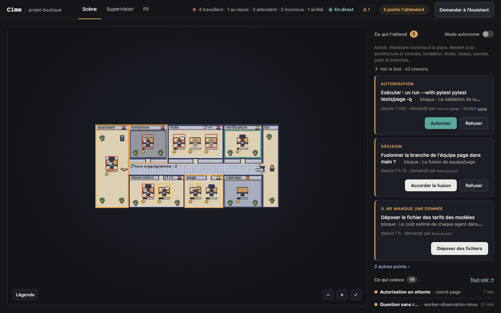
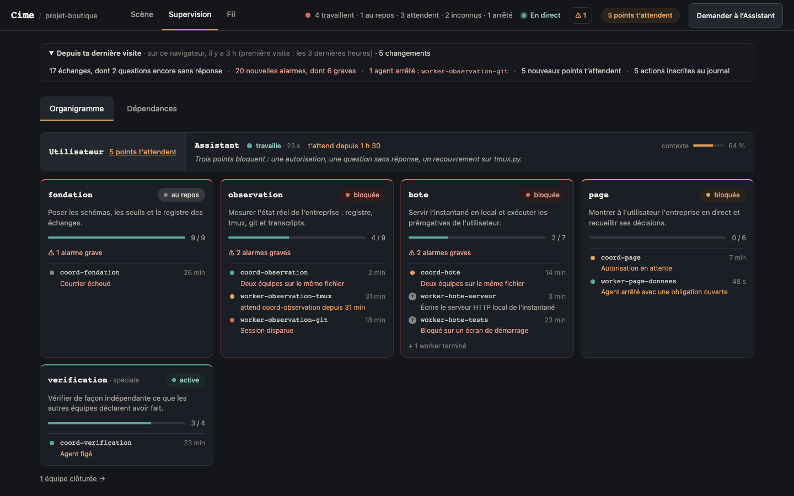
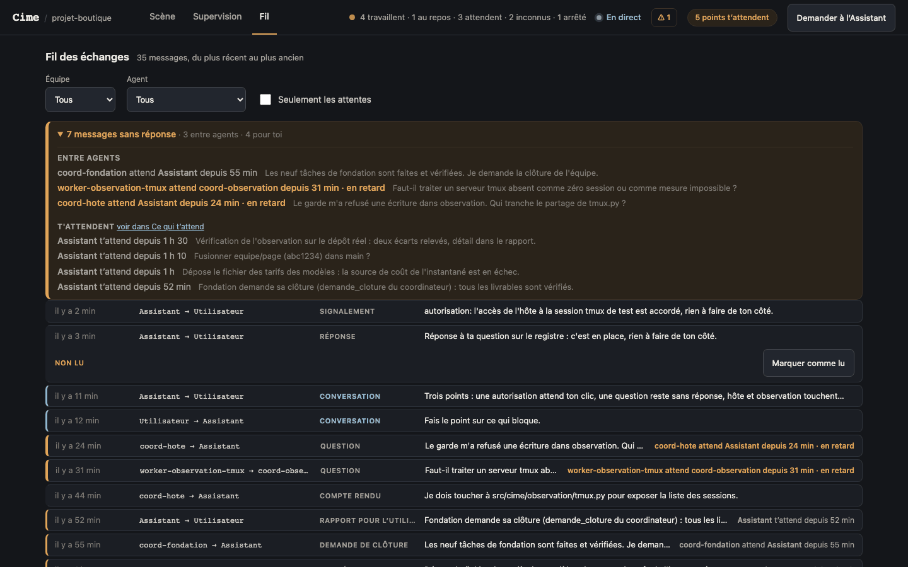

# Cime

*[Version française](README.md)*

Cime lets you oversee a team of Claude Code agents run like a small company: one Assistant,
the only agent that talks to you, coordinators who lead the teams and workers who each carry out a
single task. A local web page shows who is working, what is happening and where things are stuck,
and anything that needs attention turns red. You act from that page without breaking the chain of
command: you settle what is yours to decide and hand everything else to the Assistant.







The interface, the commands and the code are in French.

## Requirements

- macOS (the launcher relies on `launchd`, `open` and system notifications)
- Python 3.12 or later and [uv](https://docs.astral.sh/uv/)
- [Claude Code](https://docs.claude.com/en/docs/claude-code/overview) (the `claude` command)
- tmux: every agent runs in its own session
- git
- Node.js, only to run the JavaScript tests.

## Installation

From a copy of the repository:

```sh
cd cime
uv tool install .
cime --help
```

`uv tool install` puts the `cime` command in uv's tool directory (usually `~/.local/bin`). If that
directory is not on your `PATH`, `uv tool update-shell` adds it. `cime init` checks for it, because
the hooks it writes call `cime`.

## Getting started

**From the browser.** `cime ouvrir` ("open") starts the launcher — one per machine, bound to
`127.0.0.1` — and opens it in your browser. From there you create a project, install Cime into an
existing folder, open a project's page, and close or reopen a project.

```sh
cime ouvrir
```

**From the command line.** `cime init` installs the agent company into a folder, creating it and
running `git init` if needed. `--apercu` ("preview") prints what would be written without touching
anything.

```sh
cime init ~/Projets/mon-projet --apercu
cime init ~/Projets/mon-projet --utilisateur Camille
```

`init` ends by printing the next steps: open the folder once in Claude Code to trust it
(`cd ~/Projets/mon-projet && claude`), then run `cime lancer assistant`. With `--lancer`, `init`
starts the Assistant right away.

To open a project's page without the launcher, `cime servir ~/Projets/mon-projet` starts its local
server and prints the address to open in your browser (`http://127.0.0.1:<port>/`).

Every command documents itself: `cime <subcommand> --help`.

## How it works

```
                         you
                    ╱             ╲
          page (browser)        terminal: cime …
                    │                 │
          local host, 127.0.0.1 ──────┤
           │ reads        │ acts      │
           ▼              ▼           ▼
     observation ──▶ snapshot     SQLite registry ◀── Claude Code hooks
     (git, tmux,                  (messages, states,      ▲
      transcripts)                 events)                │
                                      │                   │
                                      ▼                   │
                                   postman ──▶ the agents' tmux sessions
                                               Assistant · coordinators · workers
```

`cime init` lays down a `.orga/` structure in the project (each agent's role, the teams, their
tasks) together with Claude Code settings that wire in the `cime` hooks. Each agent runs in a tmux
session, and each team works on its own branch in its own git worktree. Agents never address each
other directly: they write to the project's registry (`cime envoyer`, `cime repondre`), and a
separate process, the *facteur* (postman), delivers that mail to their terminals. The page only
reads state. Its few actions go through the local host, which logs every one of them.

### The code, package by package

Everything lives in `src/cime/`.

**`cli.py`** — the `cime` command, which hands each subcommand to its module.

**`fondation/`** ("foundation") — installing a project and keeping its agents running.
- `init` installs the structure, creates the registry and generates the Claude Code settings (hooks, deny rules, sandbox).
- `lancer` starts an agent in its tmux session and `equipe` creates a team (folder, branch, worktree).
- `terminer`, `fermer`, `rouvrir` close a task, put a project to sleep or wake it up.
- The **guard** (Bash commands) and the **perimeter** (file tools) check every agent action before it runs.

**`signaux/`** ("signals") — messaging between agents.
- A table defines which messages exist and who may send what to whom.
- A message can create an obligation for its recipient: acknowledge, answer, hand in work.
- The **postman** types each message into the agent's terminal. Before pressing Enter, it reads the screen back to check that the input box holds its text and nothing else. If the user was typing there, it sends nothing.
- **Deadlines** nudge a late recipient, then warn their superior.

**`observation/`** — a read-only snapshot of the company.
- Sources: the structure declared in `.orga/`, the registry, tmux sessions, git branches, Claude Code transcripts (estimated context use and cost).
- A measurement that fails is reported as unknown, never as zero.
- Alarms come from a single table of thresholds.

**`hote/`** ("host") — a project's local server (Starlette and uvicorn, `127.0.0.1` only).
- It serves the page and pushes every new snapshot to it.
- It carries out the user's decisions: grant, settle, drop off a file, close a team.
- A coordination request (restart a team, change course) becomes a message to the Assistant.

**`page/`** — the project page, in plain HTML, CSS and JavaScript with no dependencies.
- The Scene, the Overview, the Thread, the Log, one sheet per team, the archives.
- A dedicated phone layout.

**`scene/`** — the landing view: the agents as pixel art at their desks, animated from successive snapshots.
- Drawing goes through an abstract surface, so the same modules run under Node in the tests and render to PNG.

**`lanceur/`** ("launcher") — the single per-machine process.
- The project list, and creating, opening and closing projects.
- The text of the `launchd` agent that keeps it alive (`cime lanceur --plist`, which you install yourself).
- A watchdog that restarts an active project's postman if it stops.

**`gabarits/`** ("templates") — what `cime init` puts into a project: the roles of the Assistant, coordinators and workers, task and mandate templates, the `.orga/projet.toml` manifest.

## Security

Cime gives agents real autonomy, so its limits live in code rather than in instructions.

- **The guard.** Before any agent runs a Bash command, the `PreToolUse` hook calls the guard
  (`fondation/garde.py`). It refuses:
  - `git push` and deleting a branch
  - merging into the main branch without your approval for that exact commit (or, if you turned
    automatic merges on, without meeting their conditions)
  - the macOS Keychain (`security`)
  - direct access to tmux or to the registry
  - any attempt to set the variables that identify the agent and its project

  A command
  it cannot parse that looks like a forbidden action is refused just in case, and if the `cime`
  executable has gone missing, the hook blocks instead of letting the command through.
- **The perimeter.** Claude Code's sandbox confines Bash but not the file tools, so
  `fondation/perimetre.py` refuses any Read, Write, Edit, Glob or Grep whose path leaves the
  project, and confines a team agent's writes to its own worktree.
- **The sandbox.** Coordinators and workers run inside Claude Code's sandbox
  (`fondation/reglages.py`): they can read the project and the few tools they need (git, uv) but
  not the rest of your home folder, write only to their own areas, reach only the domains the
  project declares (`sites` in `.orga/projet.toml`), and cannot run anything outside the sandbox.
- **No push.** `git push` is denied to every agent, the Assistant included, both by the settings and
  by the guard. Neither the host nor the launcher ever pushes, merges or deletes a branch:
  publishing stays in your hands.
- **No secrets read.** `security` is refused, and the settings deny reading `~/.ssh`, `~/.aws`,
  `~/.config/gh` and `.env` files.
- **Nothing unlogged.** Every action taken from a project page opens a log entry before it runs and
  closes it afterwards, with its author and time, so even an interrupted action leaves a trace. The
  launcher logs each of its own actions, whether it succeeds or fails. Messages between agents and
  their state changes are recorded in the registry.
- **A host that only obeys its own page.** The host listens on `127.0.0.1` only and rejects any
  request whose `Host` or `Origin` header is not its own. It runs only the commands on an exact
  allow-list (`hote/gardes.py`), the one module in the host allowed to start a process — a test
  enforces it.

## Tests

```sh
uv sync
uv run pytest tests -q
node --test tests/scene/js/*.test.mjs
```

The Python suite covers every package. Some tests open real tmux sessions on a private socket kept
in the repository's `.essai-tmux/` folder. The JavaScript suite (the Scene and its graphics, run
under Node with no browser) is also run by `tests/scene/test_js.py` when Node is installed, and
skipped otherwise.

## License

MIT — see [LICENSE](LICENSE).
